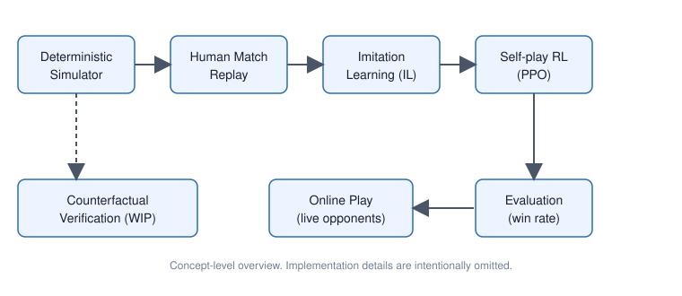
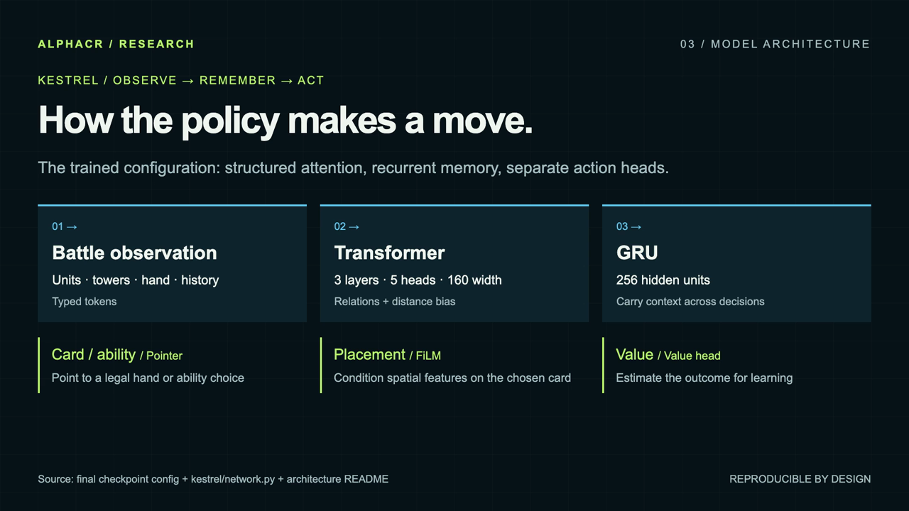

# AlphaCR

一個以「決定性模擬器」為基礎、從真人對局學習並透過自我對戰持續進步的即時對戰遊戲 AI 研究專案。本 repo 是**成果展示**，只包含數據、圖表、概念圖與文章。

> **本 repo 不含專案原始碼（僅附一個繪圖腳本 `tools/make_charts.py`）、資料或模型權重。** 展示影片（`media/`）包含遊戲對戰畫面（訓練營 NPC 對戰的原生錄影），不含任何玩家名稱。這是研究成果的展示，不是可執行或可複製的專案。
> 本專案為獨立個人研究，與遊戲的權利人無任何關聯。遊戲名稱與商標屬於其各自所有人。

## 亮點

| 項目 | 結果 |
|---|---|
| 自我對戰 RL（第 19 迭代）對 IL 基準勝率 | **71.0%**（週期評估 142/200，95% CI 64.4%–76.9%；最終評估 284/400 = 71%，與影片一致） |
| 勝率成長（第 4 → 9 → 14 → 19 迭代） | 51.0% → 64.0% → 68.5% → 71.0% |
| 線上對真人實戰（累計 265 場完成對局） | **75.8%**（201 勝） |
| 資料產生每局 CPU 時間 | 14.5 秒 → 約 10 秒（整體 **1.44 倍**） |
| 自建模擬器線 θ29（接續訓練第 3 次、第 9 輪）對 IL 基準 | **77.3%**（400 局，95% CI 72.9%–81.1%；θ19 為 73.5%） |
| 搬到官方合約（權重逐位元組相同，只換表頭）θ29_t 對 IL 基準 | **75.7%**（218/288，95% CI 70.4%–80.3%）：相對強度沒有可量到的搬遷損失 |
| 對真人玩家的線上測試對局（官方合約版本，僅彙總計數） | 284 場有勝負的對局 251 勝 33 負（88.4%）；單一場次例：12–0、12–1、18–2 |
| 跨架構逐 tick 決定性（x86_64 vs ARM64） | 50 局、227,770 tick，**0 不一致**（[文章 04](articles/04-cross-arch-determinism.md)） |
| rollout 速度 | 找出 250 倍落差的瓶頸，一行等級的修正帶來 **1.98×**（[文章 05](articles/05-rollout-250x.md)） |
| 官方合約下的 PPO | 三個 run 都停在約 52%；三個假說被否定（[文章 06](articles/06-ppo-stuck.md)） |
| 反事實驗證（進行中） | 15/34 局面完成，已完成關鍵局面 2/12 確認（[文章 07](articles/07-counterfactual-verification.md)） |

## 系統概念

模擬器 → 人類對局重演 → 模仿學習（IL）→ 自我對戰強化學習（PPO）→ 評估 → 線上對戰

（Mermaid 版本見 [diagrams/architecture.md](diagrams/architecture.md)。）

## 圖表

**RL 迭代對 IL 基準的勝率**（每點 200 局，含 95% 信賴區間）

**線上對局依對手盃數分段**

**每局 CPU 時間**

**官方合約 PPO：對起點的勝率（沒有任何 run 明確勝過起點）**

**一局 rollout 的時間分布**

**反事實驗證：已完成局面的配對勝率差（進行中）**

圖表由 `results/*.json` 產生：`python3 tools/make_charts.py`（需要 matplotlib）。

## 技術文章（草稿）

1. [為什麼要逐 tick 決定性，以及怎麼證明它可重現](articles/01-determinism.md)
2. [效能優化的意外：瓶頸其實在 Python](articles/02-python-bottleneck.md)
3. [模型的成長曲線與觀察](articles/03-growth-curve.md)
4. [跨架構逐 tick 決定性：x86_64 與 ARM64 的 50 局完全一致](articles/04-cross-arch-determinism.md)
5. [為什麼我們的 rollout 比引擎慢 250 倍：剖析與 2× 修正](articles/05-rollout-250x.md)
6. [PPO 卡住了：三個被否定的假說](articles/06-ppo-stuck.md)
7. [反事實驗證：用原生模擬證明「另一手更好」（進行中）](articles/07-counterfactual-verification.md)

## 影片

90 秒、1080p 的研究展示影片（無聲，含字卡與數據）。影片包含遊戲對戰畫面（訓練營 NPC 對戰的原生錄影，約佔 90 秒中的 40 秒），不含任何玩家名稱。

- [英文版（MP4，7.6 MB）](media/alphacr-research.mp4)
- [繁體中文版（MP4，7.5 MB）](media/alphacr-research-zh-TW.mp4)

## 數據說明

- RL 對 IL 的勝率：每個迭代各 200 局；第 19 迭代對第 14 迭代為 55.0%（110/200），統計上與 50% 難以區分。
- 對真人玩家的線上測試對局（官方合約版本）只列彙總計數，由各次執行摘要檔重算；為單一設定、多次執行的累計，沒有校正對手強度，不是排名宣稱。
- 反事實驗證為進行中的實驗，局面數與確認數會隨完成度改變；區間未作多重比較校正。
- `results/*.json` 內的 `source` 欄位以通用標籤記錄每個數字對應的內部報告或執行紀錄（原始檔不在本 repo 內）。
- 線上戰績為多個時期、多個版本的累計結果，樣本不大，僅供參考，不是排名宣稱。

## License

All rights reserved. 見 [LICENSE](LICENSE)。

---

## English summary

AlphaCR is a personal research project on a game-playing AI for a real-time head-to-head mobile game. It is built on a tick-level deterministic simulator and trained in two stages: imitation learning from human match replays, then self-play reinforcement learning (PPO).

Highlights (updated; online test matches against human players are reported as aggregate counts only): the self-play line reaches 77.3% against the IL baseline (400 games) and transfers to a new observation contract with no measurable loss (75.7%, 218/288); per-tick state is byte-identical across x86_64 and ARM64 over 50 games / 227,770 ticks; profiling explained a 250x rollout slowdown and a one-line class fix gives 1.98x; three PPO hypotheses were tested and rejected; a preregistered counterfactual-verification study is in progress (15 of 34 positions done). Earlier highlights: after 19 PPO iterations the agent beats the imitation baseline 71.0% of the time (200 games, 95% CI 64.4-76.9%; 51.0% at iteration 4, 64.0% at 9, 68.5% at 14); in 265 finished online games against live opponents it won 201 (75.8%, small pooled sample); a profiling-driven optimization cut per-game CPU time from 14.5 s to about 10 s (1.44x overall).

This repository is a showcase only. It contains **no project source code, data, or model weights**; the demo videos under `media/` contain game footage (native recordings of training-camp NPC matches, roughly 40 of 90 seconds; no player names). It includes no project source code apart from one plotting script, `tools/make_charts.py`, and is released under **All rights reserved** (no open-source license). The project is independent and not affiliated with the game's rights holder.

## 致謝 / Acknowledgements

本專案的模仿學習使用了去識別化的對局重播資料集 [IL_Replay](https://huggingface.co/datasets/VanguardX101/IL_Replay)（由 VanguardX101 發布於 Hugging Face），原始對局來自 RoyaleAPI 的公開重播。感謝資料集作者公開這份資料。

Imitation learning in this project uses [IL_Replay](https://huggingface.co/datasets/VanguardX101/IL_Replay), an anonymized battle-replay dataset published on Hugging Face by VanguardX101; the original battles come from public RoyaleAPI replays. Thanks to the dataset author for publishing it.
