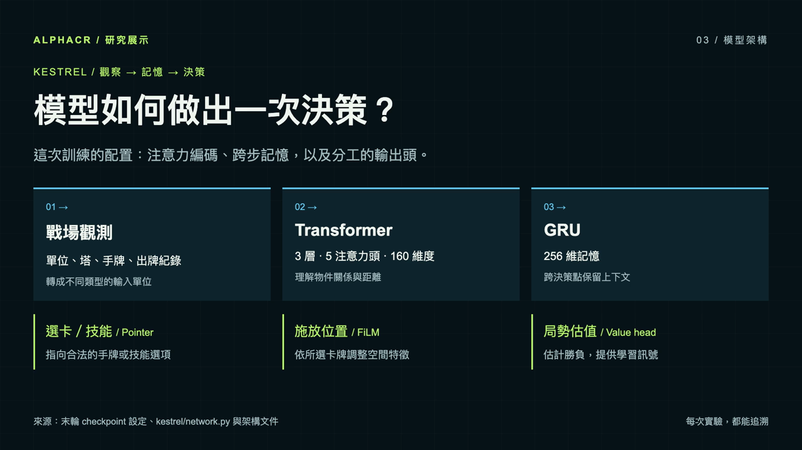
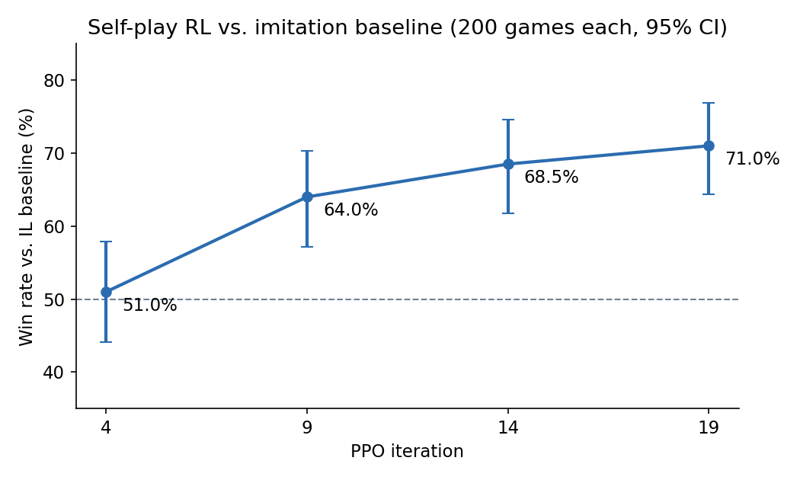
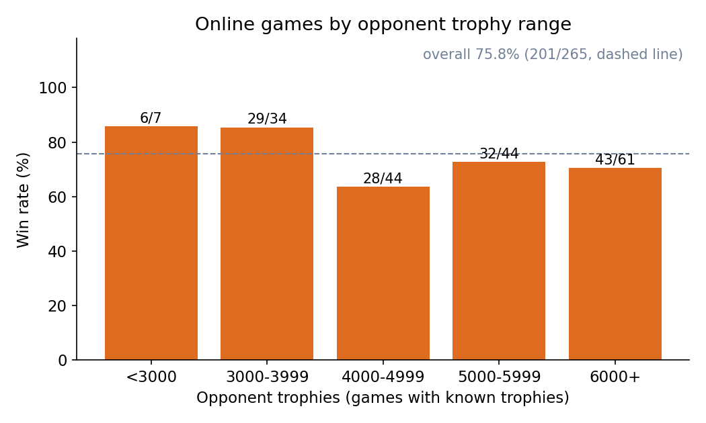
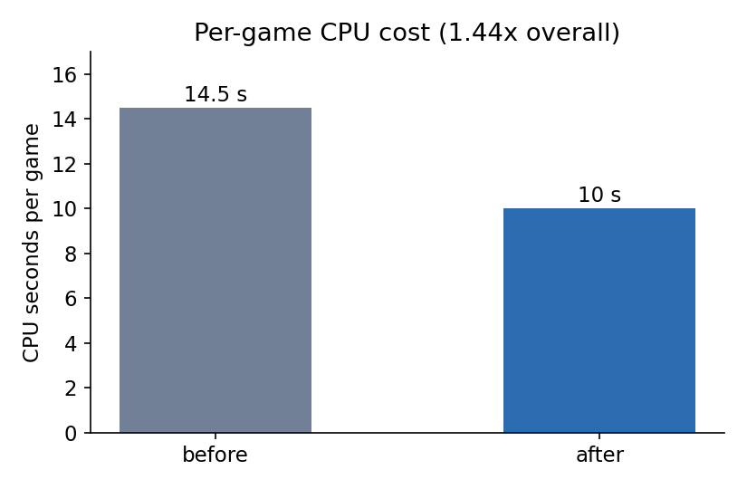
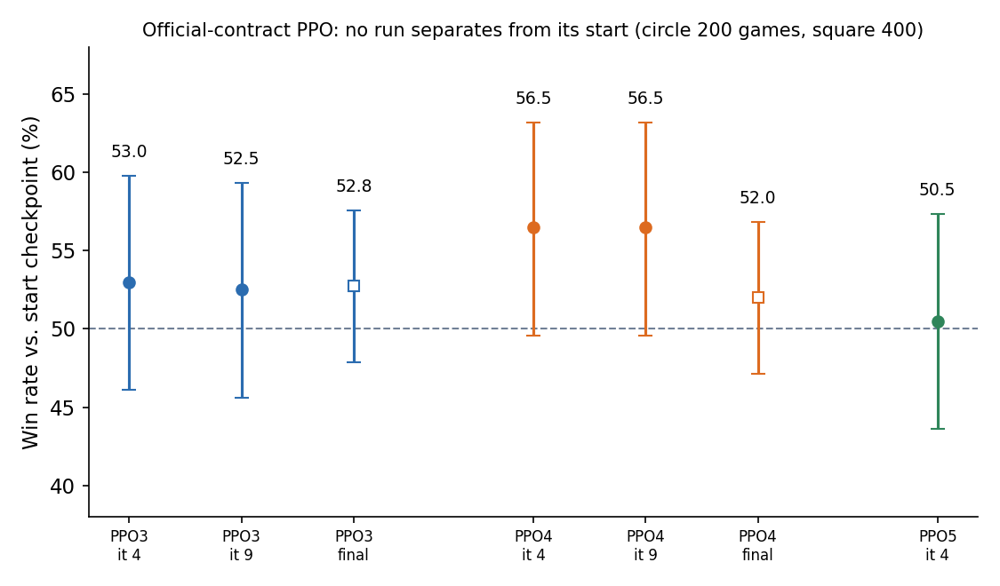

# AlphaCR：讓 AI 學會自己打牌

AlphaCR 是一個會自己打《Clash Royale》這款即時對戰手遊的 AI 研究專案。
它先看真人對局，學會什麼時候出牌、把牌放在哪裡。
接著自己跟自己對打，從勝負中練得更強，最後上線和真人交手。
這裡展示成果、研究過程與失敗的嘗試。

## AI 有多強？

- **練習後對練習前：77.3% 勝率**：對上只看真人對局學習、尚未自我對打的模型，贏了 309／400 局；這是電腦內測試，不是對真人的勝率。
- **第二代對第一代：79.5% 勝率**：第二代大腦對上第一代，贏了 318／400 局；換大腦設計後，在這組測試更會打牌。
- **訓練成本：每局約 10 秒處理器時間**，原本要 14.5 秒；同樣資源可以練更多場。這不是遊戲一局的實際長度。

數據：[訓練後的表現](results/transfer.json)、[兩代比較](results/architectures.json)、[訓練速度](results/performance.json)。這些測試回答不同問題，不能直接互相比大小，也不代表玩家排名。

## 怎麼做到的？

1. 讓電腦照同一份出牌紀錄重新進行對戰，確認每一步的場面都相同。
2. 重播真人對局，教 AI 選牌、選位置與等待時機。
3. 讓 AI 自己跟自己打，從勝負調整做法。
4. 和先前的模型對打，確認是否真的變強，再測試與真人交手。

## 模型怎麼一代代演進？

「代」指大腦設計；同一個大腦多練幾輪，不會多算一代。

| 大腦 | 看到什麼、怎麼想 | 怎麼出牌、進步在哪 |
|---|---|---|
| 第一代 | 把塔、單位與手牌整理成局勢，記住前面的行動。 | 先判斷出哪個手牌欄位，再選位置；是後續比較的起點。 |
| 第二代 | 加入物件間的關係與距離，繼續保留對局記憶。 | 直接看手中是哪張牌，來選牌與位置；對第一代勝率 79.5%（318 勝、82 敗）。 |

兩代都知道手上有什麼牌；差別在於牌的資訊怎麼接到出牌判斷。
這是整套模型的比較，還不能知道是哪個部件帶來進步。[看兩代的大腦圖與設計教訓](articles/08-model-architectures.md)。

## 靈感與目標：AlphaGo／AlphaZero

靈感來自 DeepMind 的 AlphaGo／AlphaZero：讓 AI 從對局中學習，並在出手前多想幾步。這是研究目標，目前只完成其中一部分。

- **AlphaGo（2016）**：先學人類棋譜，再靠自我對弈強化；下棋時用樹搜尋，比較後續走法。[Silver 等，Nature 2016](https://www.nature.com/articles/nature16961)。
- **AlphaGo Zero（2017）**：不用人類棋譜，從零自我對弈，結合搜尋學習。[Silver 等，Nature 2017](https://www.nature.com/articles/nature24270)。
- **AlphaZero（2017–2018）**：同樣不用人類對局資料，從零自我對弈＋搜尋，擴展到西洋棋、日本將棋與圍棋。[2017 預印本](https://arxiv.org/abs/1712.01815)；[Silver 等，Science 2018](https://doi.org/10.1126/science.aar6404)。

| 想做到的事 | AlphaCR 走到哪？ |
|---|---|
| 學人類對局 | ✓ 已做到，叫做「模仿學習」。 |
| 自我對打變強 | ✓ 已做到，用 PPO 這種依勝負調整出牌做法的訓練方法。 |
| 對戰時邊想邊搜尋 | 只有離線實驗版：MCTS（蒙地卡羅樹搜尋）比較用的基本版本已實作並驗證；勝率與速度未量測，沒接進線上對戰。 |
| 不靠人類資料，從零學起 | ✗ 還沒做。 |

不能直接照搬：這款遊戲是即時對戰，雙方能同時行動，還看不到對手手牌；跟輪流落子、棋盤完全公開的圍棋不同。
離線搜尋目前使用完整遊戲狀態，還不能代表只看玩家可見資訊的實戰能力。

這份展示不提供可執行的 AI；原始碼、訓練資料與模型權重沒有收錄，僅附繪圖腳本。

成果會受測試對手與場次影響；沒有單一數字能代表所有玩法。
想了解測試方法，可以接著看工程文章。

## 給工程師：研究圖表

圖表用語：IL 是模仿真人的學習；RL 是依勝負學習，PPO 是本專案使用的方法；rollout 是讓模型決策並推演對局；CFV 是從同一局面比較兩種走法。

**RL 迭代對 IL 基準的勝率**（每點 200 局，含 95% 信賴區間）

**線上對局依對手盃數分段**

**每局 CPU 時間**

**官方合約 PPO：對起點的勝率（沒有任何 run 明確勝過起點）**

**一局 rollout 的時間分布**

**反事實驗證：已完成局面的配對勝率差（進行中）**

圖表由 `results/*.json` 產生：`python3 tools/make_charts.py`（需要 matplotlib）。

對真人的線上測試：兩組彙總戰績與限制

- 較早、跨版本的完成對局：201／265 勝，75.8%（[資料](results/online_play.json)）。
- 使用官方客戶端輸入與出牌格式的版本：251／284 勝，88.4%（[資料](results/online_official.json)）。

兩組來自不同時期與版本，統計範圍也不同；不是同一設定的前後比較，不能用來證明升級幅度。
後者的「官方」描述軟體格式，不代表遊戲官方認可這項測試。
兩組都沒有校正對手強度，僅供參考，不是排名宣稱。

## 給工程師：技術文章

1. [重跑同一場比賽，怎麼確認過程完全一樣？](articles/01-determinism.md)：逐步比對狀態，讓訓練結果可重現。
2. [訓練太慢，該先加速哪裡？](articles/02-python-bottleneck.md)：量測發現瓶頸在引擎外圍的 Python。
3. [自己跟自己打，真的會變強嗎？](articles/03-growth-curve.md)：看成長曲線，也看後期進步的不確定性。
4. [換一種處理器，對戰過程還一樣嗎？](articles/04-cross-arch-determinism.md)：固定對局在兩種處理器上逐步一致。
5. [引擎很快，為什麼 AI 打一局還是慢？](articles/05-rollout-250x.md)：重複檢查拖慢了對局，減少重複工作後加速。
6. [繼續自我對打，為什麼沒有明顯變強？](articles/06-ppo-stuck.md)：測試三個解釋，仍沒有找到停滯原因。
7. [換一個出牌決定，真的更容易贏嗎？](articles/07-counterfactual-verification.md)：從同一局面比較兩種走法；實驗仍在進行。
8. [AI 的大腦換了什麼，實測進步多少？](articles/08-model-architectures.md)：兩代架構、比較結果，以及沒有發揮作用的設計。

## 數據怎麼讀

- 本展示保留既有研究快照；進行中的研究不代表最終結果。
- 自我對戰成長圖每點測試 200 局；末點對上一個檢查點為 110／200 勝（55.0%），尚難區分是否進步。
- 改輸入與出牌格式、權重相同的版本，對模仿真人的起點為 218／288 勝（75.7%）；與原格式的結果沒有量到明顯搬遷損失。
- 比較另一手牌的實驗完成 15／34 個局面，其中關鍵局面 2／12 確認；區間未作多重比較校正。
- 原始紀錄不在本 repo；數據檔中的 `source` 使用通用來源標籤。尚無來源標籤的既有檔案沿用原樣。

## 影片與使用範圍

- [繁體中文影片](media/alphacr-research-zh-TW.mp4)／[英文影片](media/alphacr-research.mp4)：無聲，含字卡與數據。
- 影片包含訓練營電腦對手的原生對戰錄影，不含玩家名稱。
- 本 repo 只含成果數據、圖表、概念圖、文章、影片與一個繪圖腳本；不含專案原始碼、訓練資料或模型權重，不是可執行或可複製的專案。
- 本專案為獨立個人研究，與遊戲權利人無關。遊戲名稱與商標屬於各自所有人。
- AlphaGo／AlphaZero 是 DeepMind 的研究，與本專案無關。

## English summary

AlphaCR is a personal research project that teaches an AI to play Clash Royale, a real-time head-to-head mobile game. It first learns when and where to play cards from human matches, then improves through games against itself, and finally plays online against people.

In controlled computer tests, a self-play-trained model won 309 of 400 games against its imitation-learning starting point. In a separate architecture comparison, the second-generation model won 318 of 400 games against the first. These are different tests, not player rankings. The articles explain the methods, uncertainty and failed attempts; online results are separate aggregate samples in the expandable section above.

Inspired by DeepMind’s AlphaGo and AlphaZero, AlphaCR currently combines imitation learning and PPO self-play training. Its offline full-state MCTS baseline has been implemented and validated, but its win rate and speed have not been measured, and it is not used in online play. Learning from scratch without human game data has not been done. AlphaGo and AlphaZero are DeepMind research projects and are not affiliated with this project.

This is a showcase, not an executable project. It contains no project source code, training data or model weights apart from a plotting script. The videos contain native training-camp NPC match footage with no player names. This independent project is not affiliated with the game's rights holder. All rights reserved; no open-source license is granted.

## 致謝 / Acknowledgements

本專案的模仿學習使用了去識別化的對局重播資料集 IL_Replay（`https://huggingface.co/datasets/VanguardX101/IL_Replay`）（由 VanguardX101 發布於 Hugging Face），原始對局來自 RoyaleAPI 的公開重播。感謝資料集作者公開這份資料。

Imitation learning in this project uses IL_Replay（`https://huggingface.co/datasets/VanguardX101/IL_Replay`）, an anonymized battle-replay dataset published on Hugging Face by VanguardX101; the original battles come from public RoyaleAPI replays. Thanks to the dataset author for publishing it.

## License

All rights reserved. 見 [LICENSE](LICENSE)。
