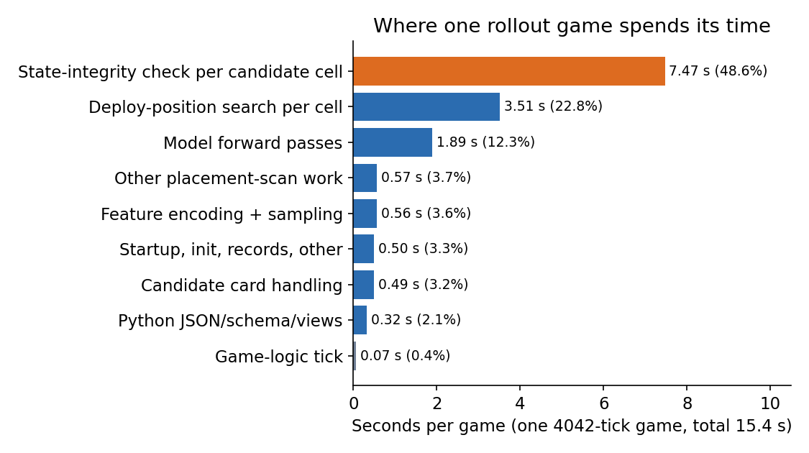

# 引擎很快，為什麼 AI 打一局還是慢？

**一句話：要找出 AI 打一局慢在哪裡，就得分開量引擎與周邊工作；這次主要浪費在逐格重複檢查，減少重複工作後速度接近加倍，修正尚未合併。**

> AlphaCR 技術筆記 05。數據：[results/rollout_profile.json](../results/rollout_profile.json)。

本文用語：rollout 是讓模型一路決策並推演對局；tick 是遊戲更新一步；checksum 是狀態內容的檢查摘要；forward 是模型算一次輸出；IPC 是程序間通訊。

**Abstract.** The deterministic game logic runs at about 65,000 ticks/s on one Apple M3 Max core, but our policy-driven rollout loop reached only 262 ticks/s, roughly 250x slower. Profiling showed that the game logic itself is 0.45% of wall time. Nearly half of the time went into a state-integrity check executed once per candidate placement cell; verifying state once per card instead gives a 1.98x speedup on self-play and 2.06x on counterfactual continuations, with identical per-decision traces and end-state checksums on the tested games. The fix has not been merged.

## 現象

純遊戲邏輯回放（不輸出逐 tick 觀測）約 65,000 tick/s。但一局由模型決策的 4,042 tick 對局（405 個決策點）要 15.4 秒，也就是 262 tick/s，差約 250 倍。第一個假設通常是「引擎慢」，這次量測直接否定它。

## 方法

1. **先量基準**：用同一台機器、單一程序、12 局 × 5 次 × 3 輪，確認純邏輯速度；每局終點 tick 與 checksum 都必須等於 golden，否則不算數。
2. **分類計時**：在決策迴圈的每一段（邏輯、落點掃描、模型、序列化、Python 端）加計時，對一局完整對局加總。
3. **取樣交叉驗證**：用系統取樣剖析器獨立檢查，結果與插樁一致（熱點函式占取樣的約 70%）。
4. **確認插樁本身沒有干擾**：開關插樁對照，差異在雜訊內。

## 時間分布（一局，15.39 秒）

| 類別 | 秒 | 占比 |
|---|---:|---:|
| 遊戲邏輯 tick | 0.07 | 0.45% |
| 落點掃描：每格一次狀態完整性檢查（186.6 萬次） | 7.47 | 48.5% |
| 落點掃描：每格部署位置搜尋 | 3.51 | 22.8% |
| 模型 forward（810 次） | 1.89 | 12.3% |
| 其餘（編碼、IPC、JSON、views、初始化等） | 約 2.4 | 約 16% |

每個決策點要判斷「哪張牌放在哪一格」，掃描 2 玩家 × 4 手牌 × 576 格 = 4,608 格。每一格都做一次狀態完整性檢查（確認「試放」沒有污染真實狀態），單次 4 到 5 微秒，成本隨場上物件數增加。整局累積約 190 萬次。IPC、序列化、JSON 合計僅約 2%：常見的「資料搬運太慢」假設也不成立。

## 修正：每張卡驗證一次，不是每格一次

同一張卡的 576 格掃描中，真實狀態並不會改變，逐格重複驗證是冗餘的。改成每張卡只驗證一次狀態完整性（連同預扣、玩家與技能狀態的核對），逐格的 tick／佇列檢查仍保留；另可加入每 N 個決策一次的全量稽核。

| 情境 | 修正前 | 修正後 | 倍率 |
|---|---:|---:|---:|
| 自我對戰 drive（一局） | 15.4 s | 7.8 s | 1.98× |
| 反事實續局（[第 7 篇](07-counterfactual-verification.md)） | 28.4 s | 13.8 s | 2.06× |

正確性檢查：3 局 drive 的逐決策 trace 雜湊與終局 checksum 完全一致；2 條續局的終局 checksum 相同。

## 其他發現與限制

- 反事實分岔每決策重複算兩次完全相同的完整觀測；預估再省約 1.6×（未實作）。
- 天花板：模型本身（每決策 2 次 forward 加編碼）約 6 ms，單程序無批次推論約 1,700 tick/s。65,000 tick/s 是不含模型的數字，不是訓練產線的目標。
- 限制：量測期間機器負載高（load average 11 到 18）；剖析用的建置組態與基準不同；只有 2 個開局、2 條續局的樣本；修正只在 3 局上驗證，合併前需要完整驗收；Linux 未試。

## 學到的事

先量「理論上限」再找瓶頸；把懷疑的東西（引擎、IPC）逐一量過，而不是直覺優化。一個「為了安全」而放在最內圈的檢查，是最容易被忽略的成本。
