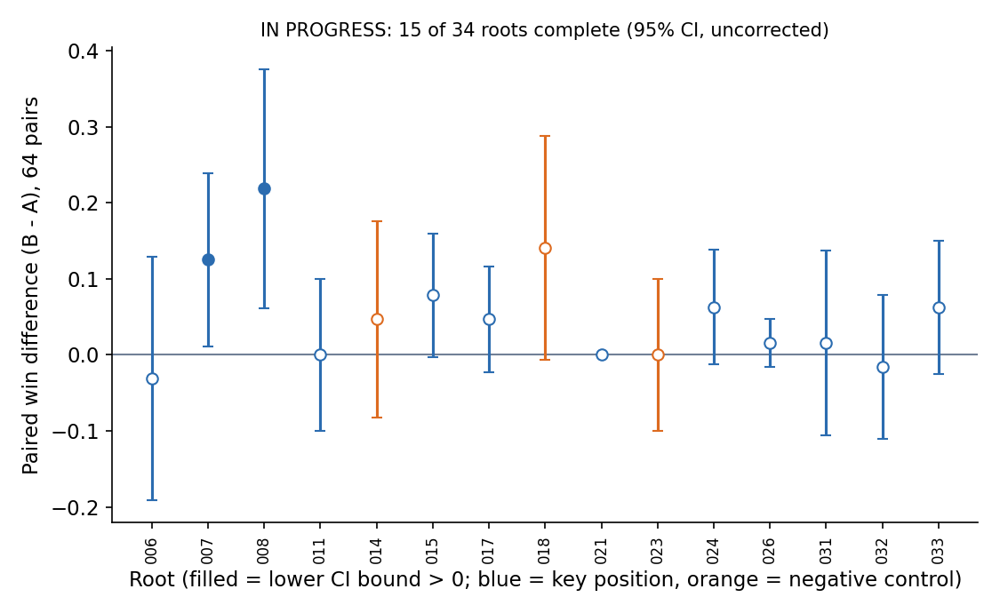

# 換一個出牌決定，真的更容易贏嗎？

**一句話：要驗證改做另一個出牌決定是否更好，就從同一局面分別走兩種做法並打到結束；目前只有部分局面確認有效，實驗仍在進行，不能作整體可靠性判定。**

> AlphaCR 技術筆記 07。**狀態：進行中（IN PROGRESS）**，34 個局面中已完成 15 個，不作整體可靠性判定。數據：[results/cfv_roots.json](../results/cfv_roots.json)。

本文用語：反事實驗證（CFV）是從同一起點比較兩種走法；tick 是遊戲更新一步；checksum 是狀態內容的檢查摘要；R3 是先前用短期搜尋挑候選動作的實驗。

**Abstract.** Can we show, not just claim, that a different move at a given position would have been better? Because the simulator is deterministic and can be snapshotted, we restore the exact same state, play move A in one branch and move B in the other, and roll both to the natural end of the game with a counter-based shared random stream (common random numbers). The protocol is preregistered, uses 64 fresh pairs per position, confirms only if the paired 95% interval is strictly above zero, and includes same-action and negative controls. Status: 15 of 34 positions done; 2 of 12 completed key positions confirm, 0 of 3 negative controls confirm. One worked example (root 008) shows a clear effect: 39/64 wins vs 53/64, delta +0.22, 95% CI [+0.06, +0.38].

## 問題

搜尋或價值網路常常告訴我們「在這個局面，B 比 A 好」。這種判斷通常來自短期估值（例如 300 tick 後的校準勝率）。它是否真的轉成「打到終局更常贏」？這需要一個不依賴同一個估值器的獨立驗證。

## 方法

1. **事先登記**（preregistration）：局面清單、A 與 B、樣本數 64、判準與決策規則在看任何結果前凍結並雜湊。20 個關鍵局面、10 個負對照、4 個正對照。
2. **同起點**：每次 A／B 都還原同一個原生快照，核對 tick、checksum 與雙方觀測雜湊；分支結束後再次檢查。
3. **對手照常反應**：對手以自己的觀測、策略與記憶每 10 tick 重新決策，不知道哪一支是 A 或 B。
4. **共同隨機數**（common random numbers）：隨機種子依局面、重複編號、座位、tick 分流，A／B 共用，配對差值的變異因此小很多。
5. **我方不多拿資訊**：模型只看得到自己能看到的資訊；完整原生狀態只用於還原。
6. **兩階段確認**：候選動作 B 在較早的搜尋階段選出（那一階段看過資料），確認階段用全新的 64 組配對、動作固定、不在確認資料上重新挑選。判準為配對差值的 95% 區間下限嚴格大於 0，不允許中途停採。
7. **負對照與 A/A 控制**：負對照是搜尋階段沒有找到更好動作的局面，若確認率高就表示方法有問題；A/A（同動作）控制必須得到完全相同的軌跡。
8. **推演到自然局尾**：勝／和／負 = 1／0.5／0，不用短視窗替代。

事先寫好的決策規則：關鍵局面至少 10/20 確認且負對照至多 1/10 確認，才算可重現；關鍵局面少於 5/20 確認，視為雜訊並檢討方法。

## 範例：局面 008

在局面 008，A 是「不出牌」，B 是一張 2 聖水的範圍法術（放在固定位置）。64 組配對、各推演到終局：

| | 勝場（64 局） |
|---|---:|
| A：不出牌 | 39 |
| B：範圍法術 | 53 |

配對差值 Δ = +0.22，95% 區間 [+0.06, +0.38]，下限大於 0，**確認**。搜尋階段預估的短期 Δ 為 +0.10；確認階段的效果比預估大，但區間很寬。局面 007 也確認（Δ +0.125，[+0.012, +0.238]）。

## 目前結果（進行中）

| 組別 | 已完成 | 確認 |
|---|---:|---:|
| 關鍵局面 | 12/20 | 2 |
| 負對照 | 3/10 | 0 |
| 正對照 | 0/4 | 0 |

已完成的 12 個關鍵局面平均 Δ 為 +0.048。多數局面的區間涵蓋 0；搜尋階段（R3）的 Δ 在這裡普遍縮小，可能是抽樣雜訊，也可能是短期估值改善沒有轉成終局改善，目前無法區分。跨對手與隱藏資訊（對手手牌配置）的穩健性測試尚未有完成的局面，因此不能宣稱「不管對手怎麼打、不知道對手手牌也一樣好」。

## 限制

- 區間未做多重比較校正；同一來源對局的局面並非完全獨立；34 個局面是固定樣本，不代表所有局面。
- 負對照不是已知零效果，確認數只代表與搜尋階段判定的分歧。
- 結論是條件於該原生狀態與隨機根快照，不聲稱涵蓋其他種子。
- 成本：目前已完成的配對共約 7.3 個程序小時，這也是[第 5 篇](05-rollout-250x.md)優化 rollout 的動機。
