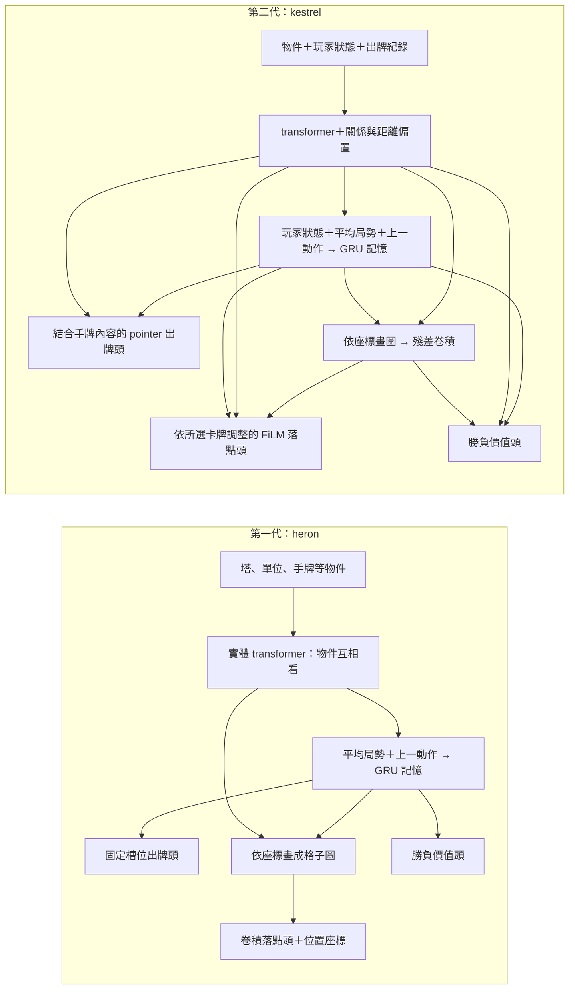

# AI 的大腦換了什麼，實測進步多少？

**一句話：第二代加入物件關係、距離與依手牌內容選牌的設計；整套模型對第一代贏了 318／400 局，但還不能把進步歸功於單一部件，而且落點設計有一部分被後續運算抵消。**

這裡的「代」指架構家族，不是訓練輪數。兩代都把場面整理成物件清單，再選牌與落點。

## 先認識兩代

| 名稱 | 工程代號 | 主要差別 |
|---|---|---|
| 第一代 | heron | 實體注意力＋跨決策記憶；按固定手牌槽位選牌 |
| 第二代 | kestrel | 加入關係／距離注意力；指向手牌內容選牌，依卡牌調整落點 |

後續自我對打訓練與換輸入、出牌格式，沿用第二代設計。換格式的版本保留原權重，不能算新一代大腦。

## 一張圖看兩代

圖中的「頭」是把內部局勢表示轉成選牌、落點或勝負估值的輸出部件。

## 第一代：先整理局勢，再選手牌欄位

| 部件 | 做什麼 | 設計用途 |
|---|---|---|
| 實體 transformer（注意力網路） | 塔、單位、手牌各是一個 token（輸入項目），讓項目互相交換資訊 | 整合不同數量的場上物件 |
| GRU（跨決策的記憶單元） | 平均局勢接上上一動作，再更新對局記憶 | 保留先前決策的資訊 |
| 線性出牌頭 | 從記憶對各個選項打分，含不出牌 | 用固定輸出位置對應選項 |
| 格子卷積落點頭 | 把物件畫到格子圖，加記憶、上一動作格子與座標圖 | 處理位置資訊；CoordConv 指額外提供橫、縱座標 |
| 價值頭 | 從記憶輸出一個局勢估值 | 為局勢打分 |

它是原先唯一的模型家族。後來加入座標圖，也把數值與卡牌等代號的可訓練向量分開編碼；這些修改沿用第一代家族名稱。
第一代不讀物件之間的關係欄位；出牌頭依固定選項打分，落點頭沒有直接讀取槽位裡那張牌的內容。

## 第二代：讓選牌與落點看得懂牌的內容

| 部件 | 改了什麼 | 理由與證據邊界 |
|---|---|---|
| 型別化 token 與 STATE token（玩家狀態項目） | 分開表達物件與玩家層級資訊；卡牌同時用語意欄位與雜湊代號向量 | 整理不同類型資訊；單一部件的增益尚未驗證 |
| 關係與距離偏置 | 注意力分數加入誰指向誰、相隔多遠 | 讓模型能利用互動關係；不能單獨宣稱它使勝率提高 |
| GRU 記憶 | 接收玩家狀態、有效物件平均與上一動作 | 延續跨決策記憶；是否必要仍待單獨比較 |
| pointer（指向手牌）出牌頭 | 用局勢查詢向量與手牌向量的相似度打分 | 換手牌順序時，輸出跟著換；不綁死固定槽位內容 |
| 殘差卷積空間主幹 | 物件按座標畫圖，再用有跳接的卷積整理 | 整合格子資訊；具體尺寸仍需實驗 |
| FiLM（依卡牌縮放與平移特徵）落點頭 | 所選手牌產生縮放 γ、平移 β，調整格子特徵 | 原意是讓不同牌選不同位置；β 後來證實無效，見下節 |
| 價值頭 | 讀記憶、玩家狀態與空間平均 | 提供局勢估值；不是額外偷看對手資訊 |

兩代的輸出都要排除不合法的選牌與格子。第二代設計來自架構研究的候選方案，再接上卡牌語意與雜湊代號表示。
設計理由只是選擇的出發點；其他遊戲或任務的論文結果，不能當成本遊戲的效果證明。

## 實際採用的尺寸與強度

第二代文件的預設是 transformer 寬度 192、4 層、6 個注意力頭；實際對戰後採用的版本是寬度 160、3 層、5 個注意力頭。它們是同一家族的尺寸設定。
第一代文件的預設為寬度 128、2 層、4 個注意力頭。

| 比較 | 結果 | 能說什麼 |
|---|---|---|
| 第二代對第一代，兩者都在模仿學習第 2 個 epoch（完整看一遍訓練資料）之後 | 換邊 400 局，318 勝、82 敗；79.5%，95% 區間 75.3%～83.2%；沒有排除對局 | 這組設定下第二代整體較強；不是對真人的勝率 |

數據見 [兩代比較](../results/architectures.json)。這是完整訓練模型的比較，沒有把每個部件分開，也不能說「強了 79.5%」。

離線整體 NLL（預測真人動作的誤差）差距沒有超過門檻，但第二代選卡誤差較低。最後因實際對戰結果採用第二代；為何離線整體誤差相近、對戰卻差很多，尚未查證。
當時只完成整體與尺寸比較；卡牌表示、關係、記憶、空間與落點等其餘部件仍待單獨比較。

## 失敗的嘗試：加了平移，卻沒有改變落點機率

FiLM 把格子特徵寫成 `S·(1+γ)+β`，再經線性讀出、softmax（把各格分數轉成機率）。
β 對同一張牌的所有格子加上相同的分數。softmax 會消掉共同常數，因此這條平移路徑沒有作用；γ 的縮放仍有作用。

- 實測 175,728 個決策，把 β 歸零或換成隨機值，格子對數機率的最大差只有 2.3e-5，屬浮點捨入量級。
- 原先規劃的「只留 β」比較從未執行，不能編出這個比較的勝負結論。
- 教訓：只確認形狀正確不夠；要從公式檢查後續運算是否抵消，再干預部件，看最終機率有沒有改變。

這個診斷沒有證明所有落點問題已解決，也沒有證明其他尚未拆開比較的部件有效。
